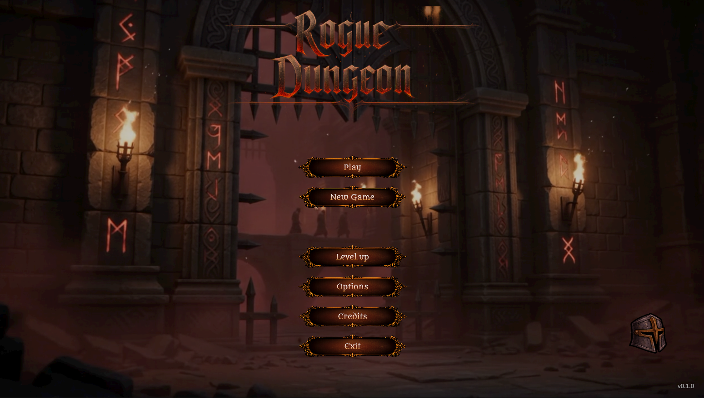
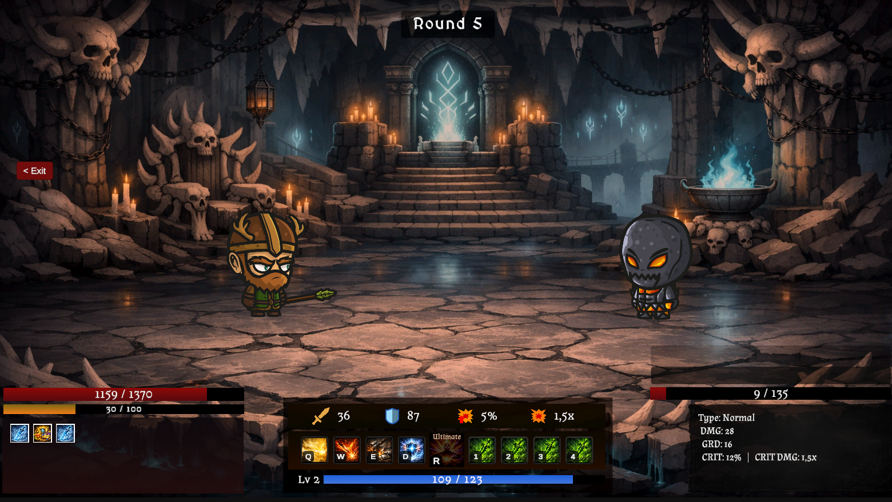
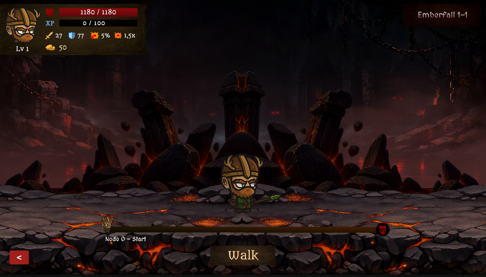
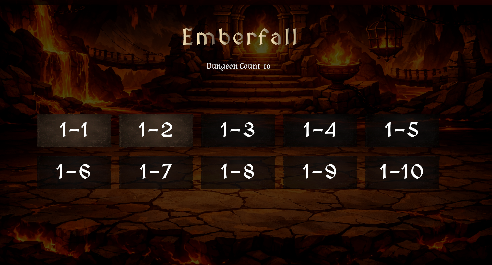
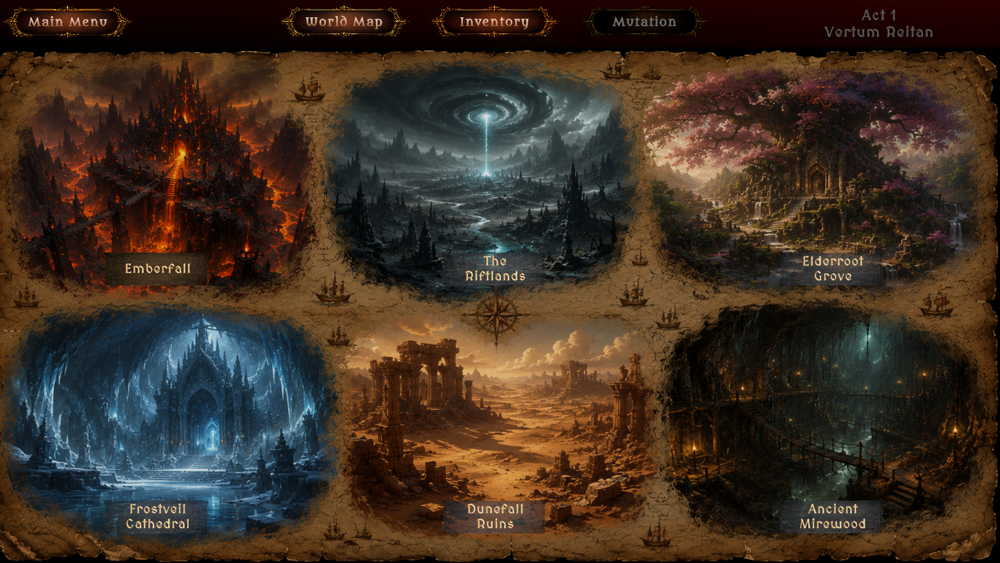
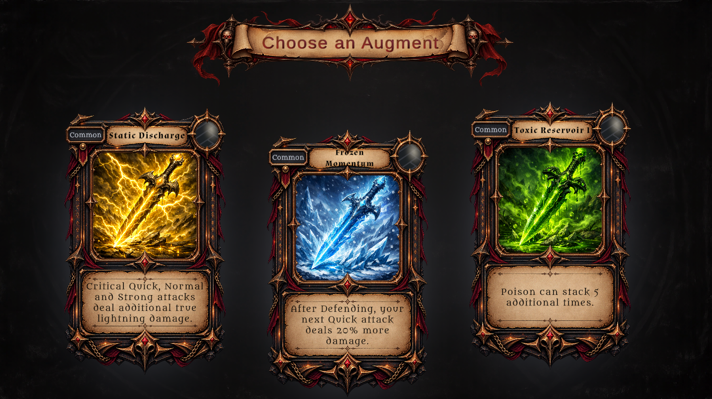
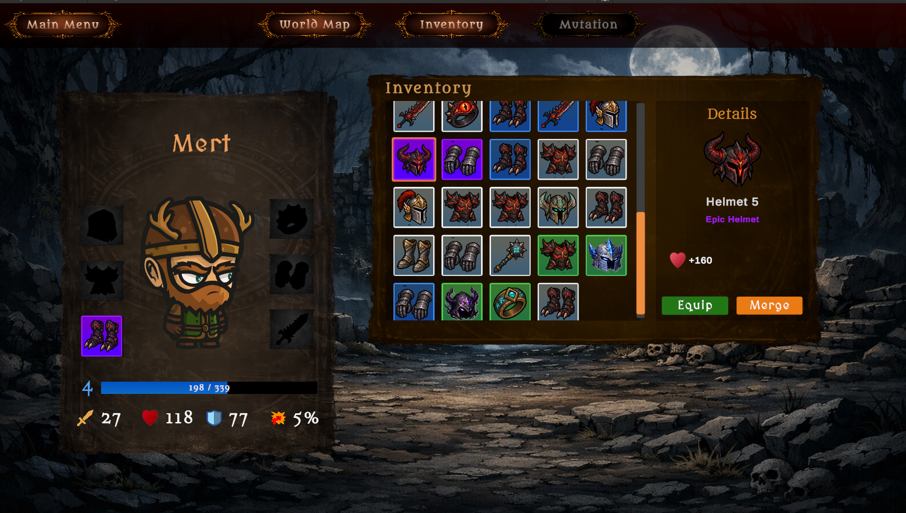

# Death Never Ends

### A Turn-Based Dark Fantasy Roguelite RPG

A solo-developed 2D roguelite RPG built with Unity and C#.

Explore dungeons, fight enemies in turn-based combat, collect equipment, and combine elemental augments to create different character builds. Every run offers new choices, strategic decisions, and opportunities to grow stronger.

**[Play the Game on itch.io](https://troemanes.itch.io/death-never-ends)**

## Gameplay

## Screenshots

### Main Menu

  

### Gameplay

<table>
  <tr>
    <td align="center" width="50%">
      <strong>Turn-Based Combat</strong>  
      
    </td>
    <td align="center" width="50%">
      <strong>Dungeon Exploration</strong>  
      
    </td>
  </tr>
  <tr>
    <td align="center" width="50%">
      <strong>Dungeon Map</strong>  
      
    </td>
    <td align="center" width="50%">
      <strong>World Map</strong>  
      
    </td>
  </tr>
</table>

### Character Progression

<table>
  <tr>
    <td align="center" width="50%">
      <strong>Elemental Augments</strong>  
      
    </td>
    <td align="center" width="50%">
      <strong>Inventory & Equipment</strong>  
      
    </td>
  </tr>
</table>

## Key Features
- Over 80+ different augments!
- Turn-based combat with different attack types and ultimate abilities
- Four elemental themes: Ignis, Toxic, Thunder, and Frost
- Augments with five rarity tiers, from Common to Legendary
- Equipment, inventory, and item merging systems
- Procedurally generated dungeon node progression
- Risk-and-reward encounters and an in-game shop
- Persistent progression between runs

## Built With

- Unity 6
- C#

## Development

This project is developed independently, with a focus on combat
systems, build variety, progression, and replayability.

## Project Status

The game is currently in active development.
The available build is a playable work in progress.

## Feedback

Feedback on combat balance, elemental synergies, augments,
and overall gameplay is welcome.

## Links

- **Play:** [Death Never Ends on itch.io](https://troemanes.itch.io/death-never-ends)
- **Developer:** [Mert Ünal](https://mertunal.com)
- **GitHub:** [mert-unl](https://github.com/mert-unl)
